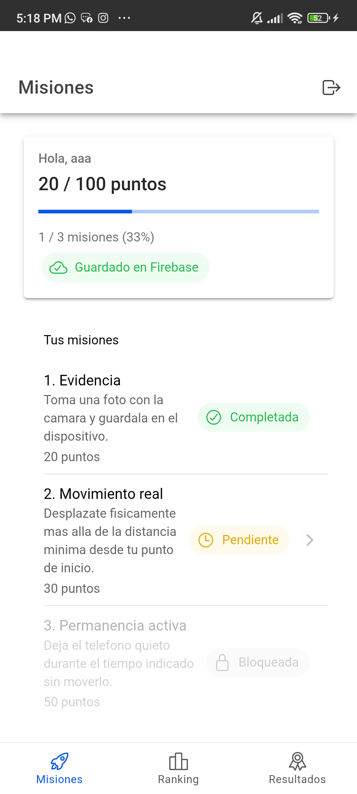
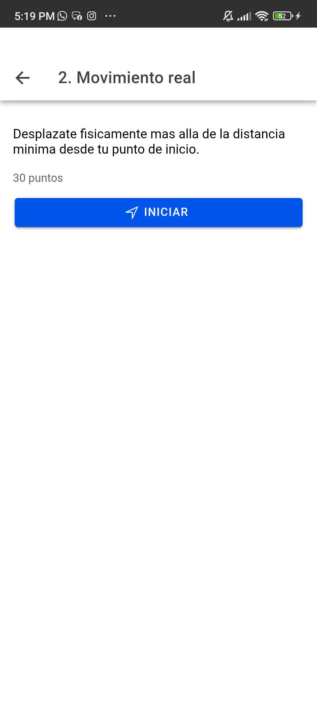
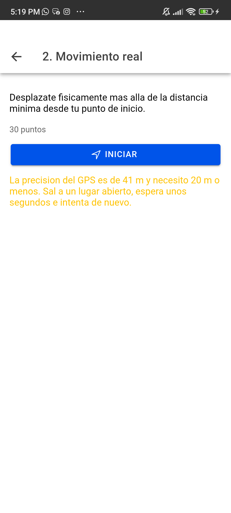
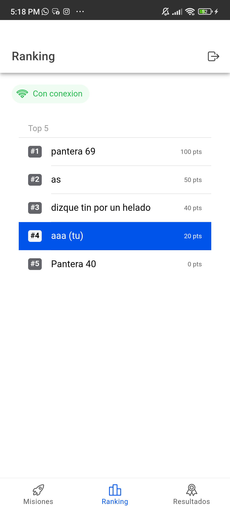
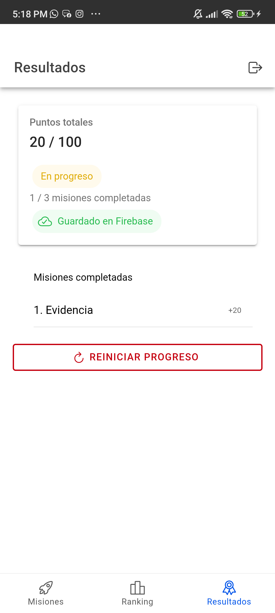
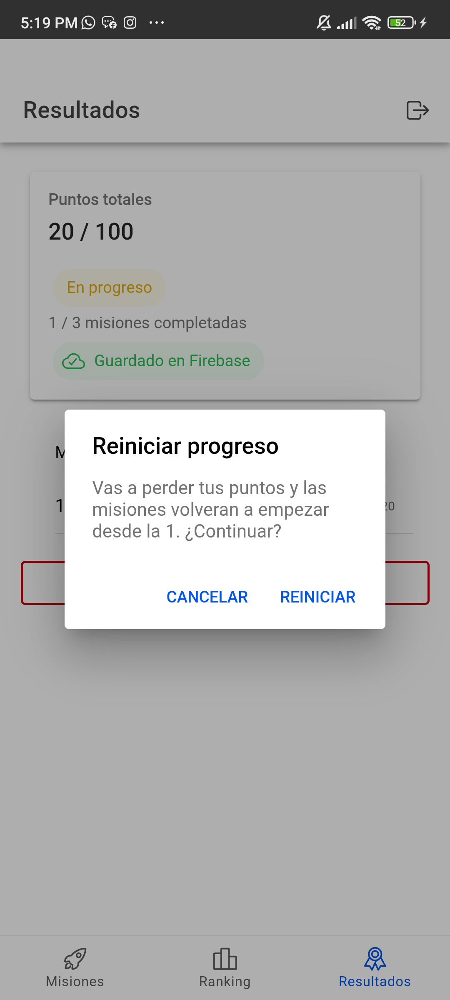

# Parcial 2 - App de misiones (Ionic + React + Capacitor)

Alex Silva · Desarrollo de Software para Plataformas Móviles (UAO) · rama `parcial-2-alex-silva`

App donde el usuario inicia sesión, completa tres misiones con los sensores del teléfono y gana puntos. El progreso se guarda en el teléfono y en Firebase, y hay un ranking en tiempo real con los demás usuarios.

| # | Misión | Puntos | Cómo se completa |
|---|---|---|---|
| 1 | Evidencia | 20 | Tomar una foto con la cámara (sin galería). Se completa al guardar el archivo `mision1_<uid>_<timestamp>.jpeg` en el dispositivo; después se ve la miniatura. |
| 2 | Movimiento real | 30 | Guarda la posición de inicio y sigue el GPS. Se completa al alejarse más de 50 m (Haversine). Descarta lecturas con precisión peor a 20 m. |
| 3 | Permanencia activa | 50 | Dejar el teléfono quieto 10 s. Si se mueve, la cuenta vuelve a empezar. Al terminar vibra 1 s. La pantalla se mantiene encendida durante la misión. |

Las misiones van en orden (1 → 2 → 3): solo la siguiente está pendiente y las demás bloqueadas. Total posible: 100 puntos.

## Video de la prueba real

Video en el teléfono con las tres misiones https://drive.google.com/file/d/1Z5ISHBK51QGFa6wgcX-XnDHZz_w7vuLU/view?usp=sharing

## Capturas

Tomadas en un Xiaomi con Android 13.

<table>
  <tr>
    <td align="center"><br>Home: puntos, progreso, sincronización y estado de cada misión</td>
    <td align="center"><br>Misión 2 antes de iniciar</td>
    <td align="center"><br>Misión 2 bajo techo: lectura de 41 m descartada (máximo 20 m)</td>
  </tr>
  <tr>
    <td align="center"><br>Ranking en tiempo real con mi fila resaltada</td>
    <td align="center"><br>Resultados: puntos, misiones completadas y estado</td>
    <td align="center"><br>Confirmación antes de reiniciar el progreso</td>
  </tr>
</table>

## Requisitos

- Node.js 20 o superior.
- Android Studio con un JDK 21 y el SDK de Android.
- Un teléfono Android con la depuración USB activada. En Xiaomi también hay que activar "Instalar vía USB" en las opciones de desarrollador.
- El archivo `.env` con las claves de Firebase (mismo proyecto de los challenges 05 y 06). Se copia de `.env.example` y no se sube al repo.

## Cómo correrlo en el navegador

```bash
cd "C:\Users\alexp\Desktop\DESARROLLO MOVIL\parcial-2"
```
```bash
npm install
```
```bash
npm run dev
```

En el navegador se pueden probar el login, el registro, la misión 1 (con la cámara del PC), el ranking y los resultados. Las misiones 2 y 3 necesitan el GPS y el acelerómetro del teléfono.

## Cómo correrlo en Android

1. Compilar la app web y copiarla al proyecto Android (`npm run build` + `npx cap sync android`):

   ```bash
   cd "C:\Users\alexp\Desktop\DESARROLLO MOVIL\parcial-2"
   ```
   ```bash
   npm run android
   ```

2. Abrir `android/` en Android Studio (**File → Open**), esperar a que termine **Gradle Sync**, elegir el teléfono y darle **Run ▶**.

   También se puede compilar e instalar desde la consola, con el teléfono conectado y desbloqueado:

   ```bash
   cd "C:\Users\alexp\Desktop\DESARROLLO MOVIL\parcial-2\android"
   ```
   ```bash
   .\gradlew.bat assembleDebug
   ```
   ```bash
   & "$env:LOCALAPPDATA\Android\Sdk\platform-tools\adb.exe" install -r app\build\outputs\apk\debug\app-debug.apk
   ```

La app pide los permisos cuando los necesita: notificaciones al iniciar sesión, cámara en la misión 1 y ubicación en la misión 2. Si se niega alguno, la app muestra un mensaje que dice dónde activarlo y sigue funcionando.

En Xiaomi, para que la notificación aparezca flotando arriba de la pantalla puede hacer falta activar **Ajustes → Apps → Misiones → Notificaciones → Notificaciones flotantes**.

## Firebase

### Reglas de Firestore

En la consola de Firebase → **Firestore Database → Reglas**, agregar este bloque **dentro** de `match /databases/{database}/documents { ... }`, junto a las reglas de los challenges (sin borrarlas), y publicar:

```
match /parcial2Users/{userId} {
  allow read: if request.auth != null;
  allow write: if request.auth != null && request.auth.uid == userId;
}
```

Cualquier usuario con sesión puede **leer** la colección (la necesita el ranking), pero cada uno solo puede **escribir** su propio documento.

### Datos que se guardan

Colección `parcial2Users`, un documento por usuario con id = `uid`:

```json
{
  "points": 50,
  "missions": [
    { "id": 1, "completed": true },
    { "id": 2, "completed": true },
    { "id": 3, "completed": false }
  ],
  "displayName": "Alex",
  "email": "...",
  "updatedAt": "<serverTimestamp>"
}
```

En el teléfono se guarda lo mismo (sin `displayName`, `email` ni `updatedAt`) en `localStorage`, con la clave `parcial2:progress:<uid>`.

Cómo se sincroniza:

- Al registrarse se crea el documento con 0 puntos.
- Al iniciar sesión se muestra primero lo guardado en el teléfono y luego se lee Firestore. Si hay conexión, Firebase manda.
- Cada cambio se guarda primero en el teléfono y luego en Firestore.
- Sin conexión, el cambio queda marcado como pendiente y se sube cuando vuelve la red. En ese caso no dejo que Firebase pise lo que se hizo sin conexión.

### Sembrar el ranking

Para probar el top 5 hacen falta otros usuarios. En **Firestore Database → Datos**:

1. Abrir la colección `parcial2Users` (o crearla con **Iniciar colección**).
2. **Agregar documento** con **ID automático** y dos campos:
   - `displayName` (string)
   - `points` (number)
3. Repetir hasta tener 4 documentos, por ejemplo:

   | displayName | points |
   |---|---|
   | Ana | 100 |
   | Luis | 80 |
   | Sofía | 50 |
   | Pedro | 30 |

Con eso, un usuario nuevo (0 puntos) queda fuera del top 5 y aparece en una fila aparte con su posición. Si se cambian los puntos de alguien en la consola, el ranking se reordena solo, sin recargar.

## Plugins y librerías

| Paquete | Versión | Para qué |
|---|---|---|
| `@capacitor/camera` | 8.2.6 | Foto de la misión 1 (`takePhoto`, solo cámara) |
| `@capacitor/filesystem` | 8.1.5 | Guardar la foto en `Directory.Data` |
| `@capacitor/geolocation` | 8.2.4 | Posición de inicio y seguimiento de la misión 2 |
| `@capacitor/motion` | 8.0.1 | Acelerómetro de la misión 3 |
| `@capacitor/haptics` | 8.0.2 | Vibración al completar la misión 3 |
| `@capacitor-community/keep-awake` | 8.0.1 | Pantalla encendida durante la misión 3 |
| `@capacitor/local-notifications` | 8.3.1 | Avisos al completar misiones |
| `@capacitor/network` | 8.0.1 | Saber si hay red para sincronizar |
| `@capacitor/core` / `@capacitor/android` | 8.5.3 | Base de Capacitor |
| `firebase` | 12.19.0 | Auth (login y registro) y Firestore |
| `@ionic/react` | 9.0.9 | Componentes de la interfaz |
| `react` | 19.3.1 | |
| `vite` / `typescript` | 8.3.5 / 6.0.3 | Compilación |

