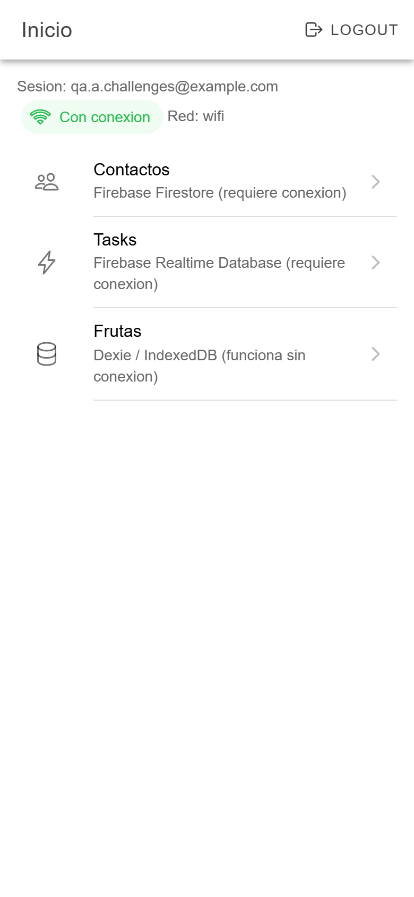
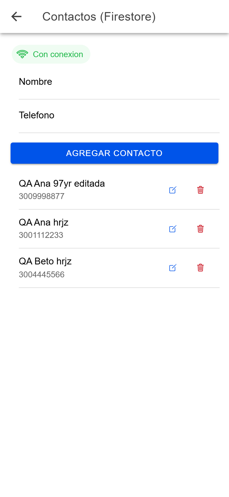
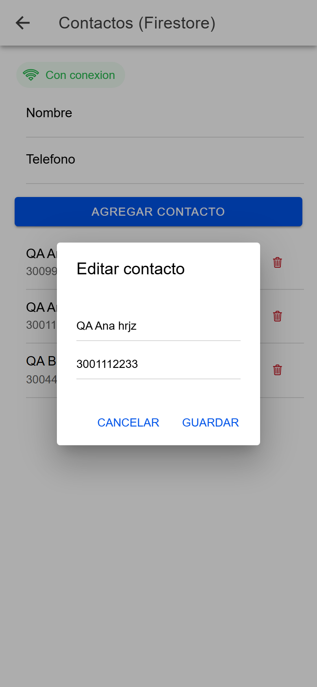
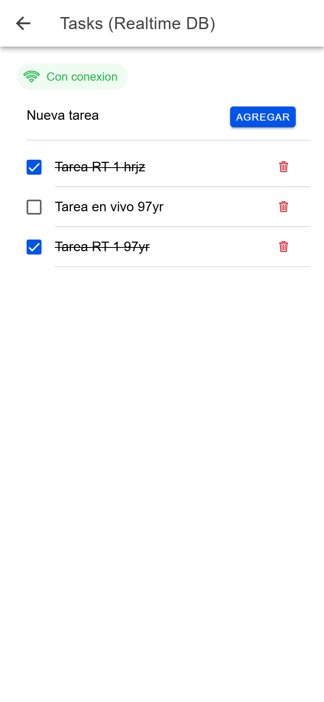
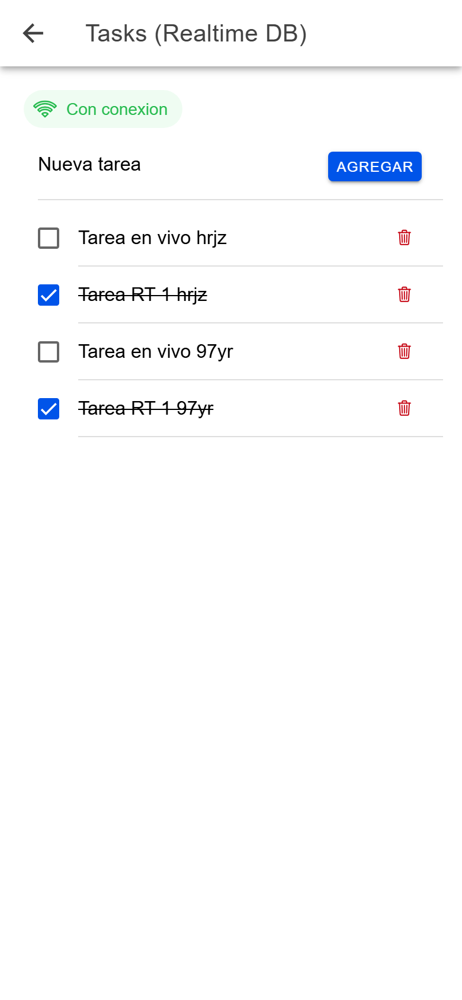
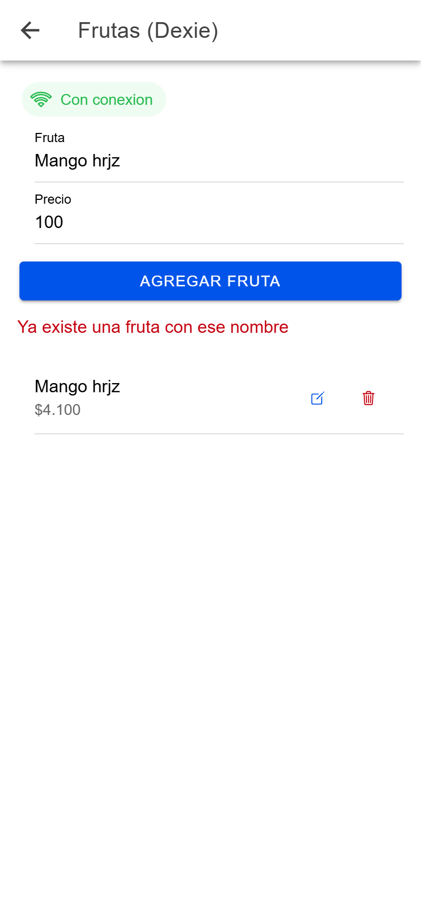
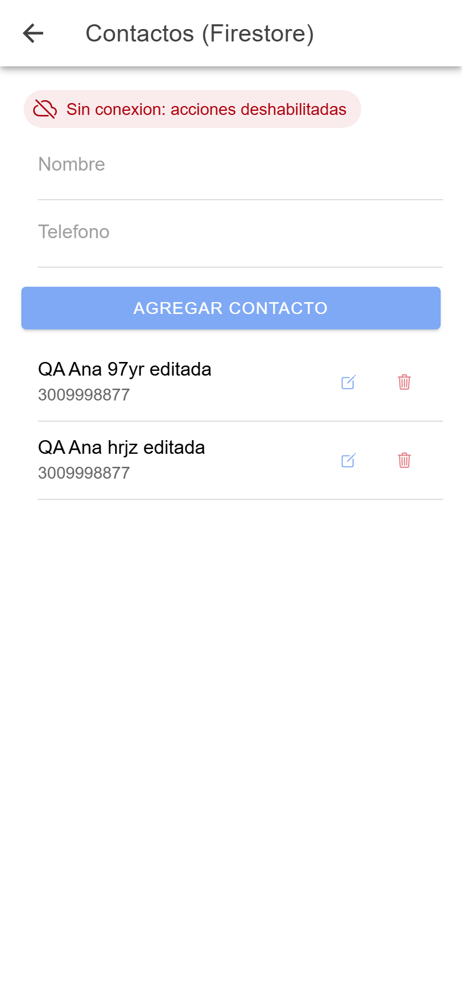
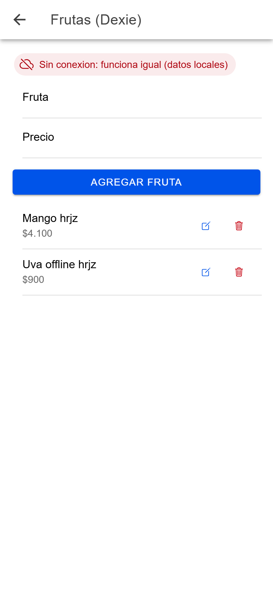

# Challenge 06 - Firebase (Firestore + Realtime DB), Dexie y Network

> Implement a new app in ionic with real login and routes to handle, based on
> the previous challenges: Contacts in Firebase. Tasks in RealTime. Fruits in
> Dexie - newFunction. Validate if you have network connection, then enable or
> disable Contacts and Tasks actions depending on the network connection.

Requisitos y donde quedaron resueltos:

- **App nueva en Ionic con login real y rutas** -> Firebase Authentication
  (`src/hooks/useFirebaseAuth.ts`, `src/context/AuthContext.tsx`, paginas
  `Login` y `Register`). Rutas en `src/routes/AppRoutes.tsx`: `/login`,
  `/register`, `/home` (menu), `/contacts`, `/tasks`, `/fruits`. Todo lo que
  no es login/registro esta protegido (`PrivateRoute`).
- **Contactos en Firebase** -> Firestore, coleccion `contacts` (un contacto
  guarda el `uid` de su dueno; cada usuario ve solo los suyos).
  Pagina `src/pages/ContactsPage.tsx`, hook `src/hooks/useCollection.ts`
  (getAll con filtros, add, update, remove, como en la Clase 06).
- **Tasks en RealTime** -> Realtime Database, ruta `tasks/{uid}`. Pagina
  `src/pages/TasksPage.tsx`, hook `src/hooks/useRealTimeCollection.ts`
  (getAll, add con `push`, update, remove y `onValue`: la lista se actualiza
  sola, sin recargar).
- **Fruits in Dexie - newFunction** -> IndexedDB con Dexie: base
  `src/db/fruitsDb.ts` (`++id, &name, price`), hook `src/hooks/useDexie.ts`
  y pagina `src/pages/FruitsPage.tsx`. **"newFunction"**: la consigna no lo
  aclara; lo interprete como la funcion nueva de esta clase para Dexie,
  `useLiveQuery`, que actualiza la lista sola cuando cambia la tabla (confirmar
  con el profesor si se referia a otra cosa).
- **Validar la conexion y habilitar/deshabilitar acciones de Contactos y
  Tasks** -> `src/hooks/useNetwork.ts` (`@capacitor/network`:
  `Network.getStatus()` + evento `networkStatusChange`). Sin conexion, en
  Contactos y Tasks se deshabilitan los campos y los botones de agregar,
  editar, eliminar y completar, y se muestra el aviso
  (`src/components/NetworkBanner.tsx`). Frutas NO se deshabilita porque los
  datos son locales y funciona sin internet. Al volver la red, Contactos se
  recarga solo.

Notas:

- Dexie 4 + `useLiveQuery` lanzan un `TypeError` interno (y tumban la pantalla)
  si un `add` falla por el indice unico `&name`. Por eso `useDexie.add` revisa
  primero si el nombre ya existe y muestra "Ya existe una fruta con ese
  nombre".
- Como en el Challenge 05, las redirecciones usan `RedirectOnce` en vez de
  `<Navigate>` (ver el README del Challenge 05).

## Capturas

Pruebas en el navegador con viewport de celular (390x844), usando cuentas de prueba.

<table>
  <tr>
    <td align="center"><br>Menú (Home) con las 3 secciones</td>
    <td align="center"><br>Contactos en Firestore</td>
    <td align="center"><br>Editar contacto</td>
  </tr>
  <tr>
    <td align="center"><br>Tasks en Realtime Database</td>
    <td align="center"><br>Tiempo real: pestaña 1 agrega la tarea</td>
    <td align="center"><br>Tiempo real: aparece sola en la pestaña 2</td>
  </tr>
  <tr>
    <td align="center"><br>Frutas en Dexie: nombre repetido</td>
    <td align="center"><br>Sin conexión: Contactos deshabilitado</td>
    <td align="center"><br>Sin conexión: Frutas sigue funcionando</td>
  </tr>
</table>

## Configurar Firebase

Si ya hiciste el Challenge 05 puedes usar el mismo proyecto (paso 1 y 2 ya
estan hechos). Si no:

1. https://console.firebase.google.com/ > crear proyecto.
2. **Build > Authentication > Comenzar** y activa **Correo electronico/
   contrasena**.
3. **Configuracion del proyecto > General > Tus apps > </>** para registrar
   la app web y copiar el `firebaseConfig`.
4. **Build > Firestore Database > Crear base de datos** (modo produccion,
   cualquier region). En la pestana **Reglas** pega y publica:

   ```
   rules_version = '2';
   service cloud.firestore {
     match /databases/{database}/documents {
       match /contacts/{id} {
         allow read, update, delete: if request.auth != null && resource.data.uid == request.auth.uid;
         allow create: if request.auth != null && request.resource.data.uid == request.auth.uid;
       }
     }
   }
   ```

5. **Build > Realtime Database > Crear base de datos** (modo bloqueado).
   Copia la URL que aparece arriba (algo como
   `https://TU-PROYECTO-default-rtdb.firebaseio.com`). En **Reglas** pega y
   publica:

   ```
   {
     "rules": {
       "tasks": {
         "$uid": {
           ".read": "auth != null && auth.uid === $uid",
           ".write": "auth != null && auth.uid === $uid"
         }
       }
     }
   }
   ```

6. Copia `.env.example` como `.env` y pega los valores (incluida
   `VITE_FIREBASE_DATABASE_URL`).

## Como correrlo

```bash
npm install
npm run dev
```

Registrate en "No tengo cuenta". Para ver la validacion de red: en Chrome
DevTools > Network > "Offline" (o modo avion en el telefono) y entra a
Contactos o Tasks.

## Netlify (opcional)

`public/_redirects` ya trae `/* /index.html 200`. `npm run build` y subir la
carpeta `dist`.
